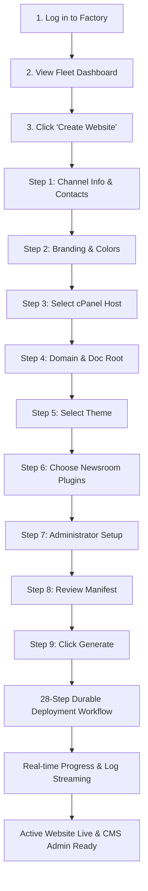

# Product Requirements Document (PRD)
# Earthin Website Factory — Vercel Edition

## 1. Executive Summary
Earthin Website Factory is an internal platform that automates the deployment, provisioning, and lifecycle management of independent news websites powered by **Earthin News CMS**. It eliminates manual server management, database configuration, FTP uploads, and PHP installer wizards by providing a streamlined 9-step website generator on Vercel.

---

## 2. Target Users & Personas

1. **Non-Technical Website Operators**:
   - Needs to launch a news website for a new city or regional franchise in minutes.
   - Enters channel details, uploads logos, picks colors, selects domain, and clicks generate.
2. **Platform Administrators**:
   - Manages cPanel server connections, verifies quotas and health.
   - Approves CMS releases, themes, and plugins.
   - Monitors deployment queues, manages backups, and handles rollbacks.
3. **Super Administrators**:
   - Manages team roles, audits activity logs, configures cryptographic keys, and manages system settings.
4. **Viewers & Stakeholders**:
   - Read-only visibility into live website inventory, deployment history, and uptime status.

---

## 3. Product Workflows & User Journey

---

## 4. Functional Requirements

### 4.1 Authentication & RBAC
- Secure session tokens stored in HttpOnly, SameSite=Lax cookies.
- Password hashing with bcrypt (12 rounds).
- Granular permission checking on all API route handlers and server actions.
- Audit logging for all authentication and administrative actions.

### 4.2 Website Creation Wizard
- 9 distinct steps with validation: Information, Branding, Hosting, Domain, Theme, Plugins, Administrator, Review, Generate.
- Client-side direct upload for PNG, SVG, ICO logos with dimensions preview.
- Real-time cPanel host capability detection (PHP 8.3+, MySQL 8.0+).
- Duplicate domain validation and DNS verification.

### 4.3 cPanel Integration Engine
- Modular adapter pattern supporting internal and external customer cPanels.
- Automated creation of MySQL databases and users with cPanel user prefixing (`{cpanel_user}_{slug}_{rand}`).
- Granting `ALL PRIVILEGES` to dedicated database user.
- Package extraction via `Fileman::extract_files`.
- Generation of production `.env` with encrypted secrets and `APP_KEY`.

### 4.4 Automated Installation Handoff
- Dedicated endpoint `POST /install/factory-deploy` on the deployed CMS.
- Cryptographically signed with HMAC-SHA256 and verified against `DEPLOYMENT_SIGNING_KEY`.
- Nonce and timestamp validation (15-minute validity window) for replay attack prevention.
- Silent non-destructive database migrations, roles & permissions seeding, starter Hindi categories seeding, active theme configuration, plugin activation, and super admin account creation.
- Permanent installation seal (`installed.lock`).

### 4.5 Deployment Monitoring
- Real-time step-by-step progress tracking across all 28 steps.
- Persistence in PostgreSQL: browser refreshes never reset or lose deployment state.
- Per-step attempt counter (up to 3 retries) and error diagnostics.
- Manual retry action for failed steps.
- Cancellation action for running workflows.
- Downloadable JSON deployment audit report.

### 4.6 Backups & Restores
- One-click MySQL database snapshot backups.
- SHA-256 bit-level integrity verification.
- Safe rollback / restore workflow.

---

## 5. Non-Functional Requirements

- **Availability & Resilience**: Fully serverless and stateless application layer hosted on Vercel with zero single-point-of-failure servers.
- **Security**: AES-256-GCM encryption for all sensitive credentials at rest; no plaintext API tokens stored in database or exposed in logs.
- **Performance**: Sub-2-second page loads, responsive desktop and mobile views.
- **Scalability**: Target of 100+ independent newsrooms across multiple cPanel clusters with concurrency controls per host.
